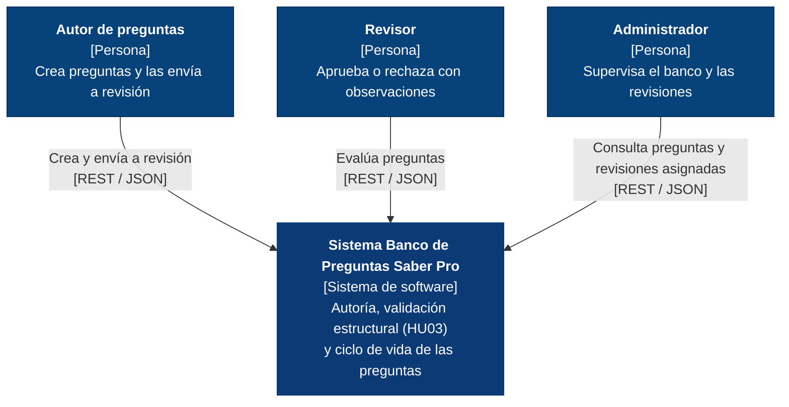
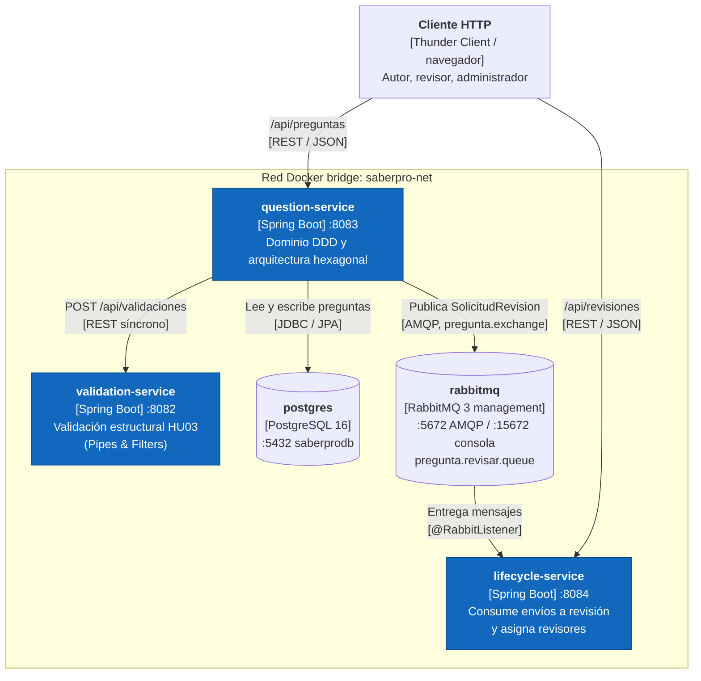
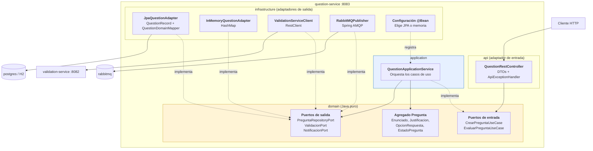
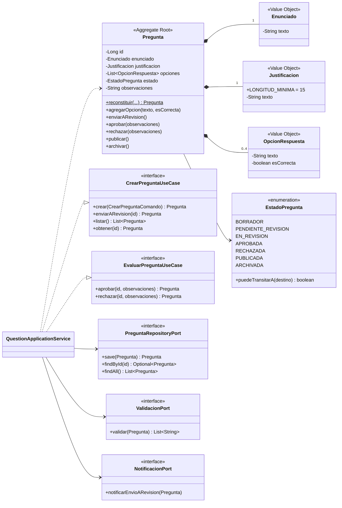
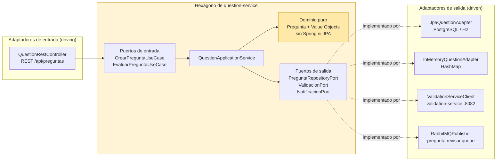
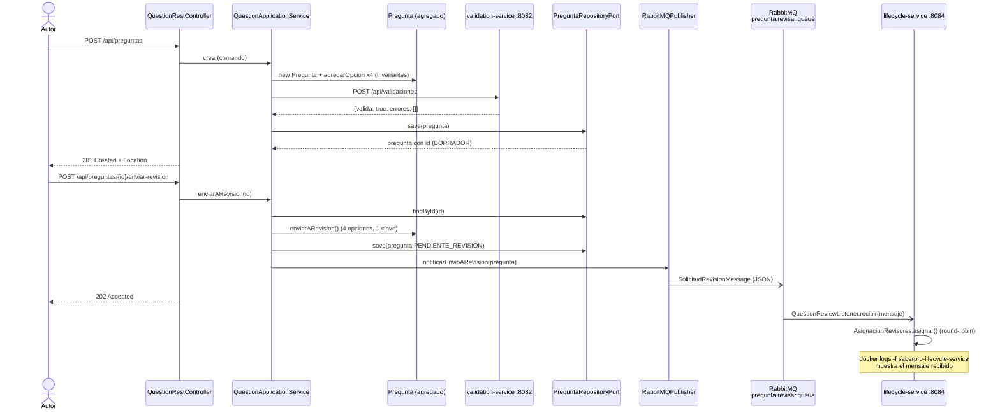

# saberpro-banco-preguntas

Banco de Preguntas Saber Pro: entrega final (Taller 13) del Laboratorio de Ingeniería de Software II,
Universidad del Cauca, 2026.2. Integra DDD, arquitectura hexagonal y microservicios contenerizados con Docker Compose.

## Microservicios

| Servicio | Puerto | Responsabilidad |
|---|---|---|
| `validation-service` | 8082 | Validación estructural de preguntas (HU03) por REST síncrono |
| `question-service` | 8083 | Servicio principal: dominio puro, puertos y adaptadores (JPA / memoria / RabbitMQ) |
| `lifecycle-service` | 8084 | Ciclo de vida: consume los envíos a revisión desde RabbitMQ |
| `rabbitmq` | 5672 / 15672 | Broker AMQP y consola de administración |

Todos los contenedores se comunican por la red bridge `saberpro-net`.

## API de question-service (:8083)

| Método y ruta | Respuesta |
|---|---|
| `GET /api/preguntas` | 200 con la lista |
| `GET /api/preguntas/{id}` | 200, o 404 si no existe |
| `POST /api/preguntas` | 201 con la pregunta y `Location`; 400 si incumple una regla o la validación de `validation-service`; 503 si `validation-service` no responde |
| `POST /api/preguntas/{id}/enviar-revision` | 202 Accepted (la revisión sigue por RabbitMQ) |
| `POST /api/preguntas/{id}/aprobar` | 200; body opcional `{"observaciones": "..."}` |
| `POST /api/preguntas/{id}/rechazar` | 200; 400 si falta `{"observaciones": "..."}` |

La URL de `validation-service` se configura con `SABERPRO_VALIDATION_URL` (por defecto `http://localhost:8082`;
en Docker, `http://validation-service:8082`).

## Estructura

```
saberpro-banco-preguntas/
├── docker-compose.yml
├── README.md
├── validation-service/        (:8082)  co.edu.unicauca.saberpro.validation
│   └── api/
├── question-service/          (:8083)  co.edu.unicauca.saberpro.question
│   ├── domain/                dominio puro (sin @Entity ni Spring)
│   │   ├── model/
│   │   ├── exception/
│   │   └── ports/{inbound,outbound}/
│   ├── application/           servicios de aplicación
│   ├── infrastructure/{jpa,memory,messaging,validation,config}/
│   └── api/                   controlador REST
└── lifecycle-service/         (:8084)  co.edu.unicauca.saberpro.lifecycle
    └── messaging/
```

## Ejecutar en local (sin Docker)

Cada servicio es un proyecto Maven independiente con su wrapper:

```bash
cd question-service
./mvnw test                         # pruebas
./mvnw clean package -DskipTests    # genera target/question-service.jar
./mvnw spring-boot:run
```

## Ejecutar con Docker

Cada servicio tiene un `Dockerfile` multi-stage en su raíz: la primera etapa compila el `.jar` con Maven
(equivale a `./mvnw clean package -DskipTests`) y la segunda lo ejecuta sobre `eclipse-temurin:17-jre`.
No hace falta compilar antes a mano. Se usa `eclipse-temurin` porque `openjdk:17-jdk-slim`, la imagen
de la guía, está descontinuada en Docker Hub.

```bash
docker compose up -d --build
docker ps
docker logs -f saberpro-question-service
```

`docker compose up -d --build` levanta 5 contenedores en la red `saberpro-net`:

| Contenedor | Imagen | Puertos | Arranca después de |
|---|---|---|---|
| `saberpro-rabbitmq` | `rabbitmq:3-management` | 5672, 15672 | — |
| `saberpro-postgres` | `postgres:16-alpine` | 5432 | — |
| `saberpro-validation-service` | build `./validation-service` | 8082 | — |
| `saberpro-question-service` | build `./question-service` | 8083 | RabbitMQ y PostgreSQL sanos, validation-service |
| `saberpro-lifecycle-service` | build `./lifecycle-service` | 8084 | RabbitMQ sano |

Variables que inyecta el compose (en local se usan los valores por defecto de `application.properties`):

| Servicio | Variable | Valor en Docker | Valor local |
|---|---|---|---|
| question-service | `SPRING_DATASOURCE_URL` | `jdbc:postgresql://postgres:5432/saberprodb` | H2 en memoria |
| question-service | `SABERPRO_VALIDATION_URL` | `http://validation-service:8082` | `http://localhost:8082` |
| question-service | `SABERPRO_PERSISTENCIA` | `jpa` (PostgreSQL) | `jpa` (H2); `memoria` usa el `InMemoryQuestionAdapter` |
| question-service, lifecycle-service | `SPRING_RABBITMQ_HOST` | `rabbitmq` | `localhost` |

- Consola de RabbitMQ: <http://localhost:15672> (`guest` / `guest`), cola `pregunta.revisar.queue`.
- Revisiones recibidas por lifecycle-service: `GET http://localhost:8084/api/revisiones`.
- Detener todo: `docker compose down` (añadir `-v` para borrar también los datos de PostgreSQL).

## Diagramas

Fuentes Mermaid en `docs/diagramas/*.mmd` y exportados a PNG (mismo nombre) para el informe.
Para regenerar los PNG: `npx -p @mermaid-js/mermaid-cli mmdc -i docs/diagramas/<nombre>.mmd -o docs/diagramas/<nombre>.png -b white`.

### C4 nivel 1: Contexto

Fuente: [`c4-contexto.mmd`](docs/diagramas/c4-contexto.mmd) · PNG: [`c4-contexto.png`](docs/diagramas/c4-contexto.png)



### C4 nivel 2: Contenedores

Fuente: [`c4-contenedores.mmd`](docs/diagramas/c4-contenedores.mmd) · PNG: [`c4-contenedores.png`](docs/diagramas/c4-contenedores.png)



### C4 nivel 3: Componentes de question-service

Fuente: [`c4-componentes.mmd`](docs/diagramas/c4-componentes.mmd) · PNG: [`c4-componentes.png`](docs/diagramas/c4-componentes.png)



### C4 nivel 4: Código (agregado Pregunta y puertos)

Fuente: [`c4-codigo.mmd`](docs/diagramas/c4-codigo.mmd) · PNG: [`c4-codigo.png`](docs/diagramas/c4-codigo.png)



### Arquitectura hexagonal de question-service

Fuente: [`hexagonal.mmd`](docs/diagramas/hexagonal.mmd) · PNG: [`hexagonal.png`](docs/diagramas/hexagonal.png)



### Secuencia: crear → enviar a revisión → RabbitMQ → lifecycle-service

Fuente: [`secuencia.mmd`](docs/diagramas/secuencia.mmd) · PNG: [`secuencia.png`](docs/diagramas/secuencia.png)


